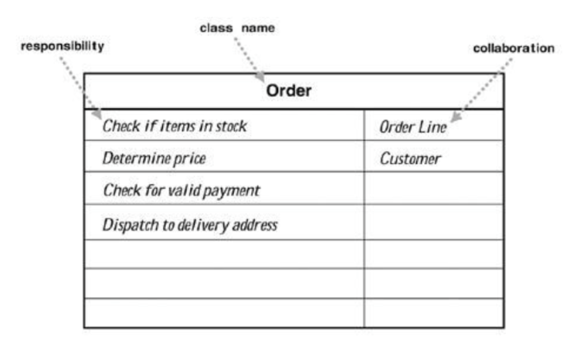

# Cell Society Design Lab Discussion
#### Michael Li - mll80, Joseph Wang - jhw45, Georgiy Zemlevskiy - gz78


Segregation: model agent simulation, meaning that as long as the current ratio blocks of preferred / similar blocks is less than a value, then it moves to a position of a better value (the position next to it).

Forest fire: 3 states: empty, 

Game of life: Live or dead cell

    1. Any live cell with < 2 neighbors dies or > 3 neighbors dies
    2. Any dead cell with exactly 3 neighbors becomes alive

The game of life will run for a given time. 

### Simulations

 * Commonalities
 The commonality is that all of them have specific sets of rules, which alter block states based on the neighbors around them. 

 * Variations
 The variation of the segregation game is that the blocks actually move across the board when dealing with ratios, and the forest-fire models depend on probability p, and game of life deals with certainties of whether or not a cell is dead/alive.


### Discussion Questions

 * How does a Cell know what rules to apply for its simulation?

 Game of Life: Check number of live/dead neighbors and use 4 rules.
 Forest-fire: Also conforms to the 4 rules that affects its states
 Segregation: Also dependent on neighbors on where to move

 * How does a Cell know about its neighbors?
 Parse directions in a 8-directional array.

 * How can a Cell update itself without affecting its neighbors update
 The game of life and forest fire can update on a row by row, column by column. Segregation operates on a first-come-first serve basis.

 * What behaviors does the Grid itself have?
 The grid is a (m x n) grid, where m is number of rows and n is the number of columns. Each cell has a certain number of states, and these states are updated on the certain set of rules.

 * How can a Grid update all the Cells it contains?

 Looping through row by row, column by column.

* What information about a simulation needs to be in the configuration file?

The simulation needs its preset identities, like a set probability, number of block states, etc.


 * How is configuration information used to set up a simulation?

Grid size set up, along with initializing the board with its states.

 * How is the graphical view of the simulation updated after all the cells have been updated?

Go through a new grid and set its states, after parsing through the old grid.


### Alternate Designs

#### Design Idea #1

 * Data Structure #1 and File Format #1

 * Data Structure #2 and File Format #2


#### Design Idea #2

 * Data Structure #1 and File Format #1

 * Data Structure #2 and File Format #2
 
 

### High Level Design Goals


### CRC Card Classes

This class's purpose or value is to represent a customer's order:



This class's purpose or value is to represent a customer's order:

|Order| |
|---|---|
|boolean isInStock(OrderLine)         |OrderLine|
|double getTotalPrice(OrderLine)      |Customer|
|boolean isValidPayment (Customer)    | |
|void deliverTo (OrderLine, Customer) | |


This class's purpose or value is to represent a customer's order:
```java
public class Order {
     // returns whether or not the given items are available to order
     public boolean isInStock (OrderLine items)
     // sums the price of all the given items
     public double getTotalPrice (OrderLine items)
     // returns whether or not the customer's payment is valid
     public boolean isValidPayment (Customer customer)
     // dispatches the items to be ordered to the customer's selected address
     public void deliverTo (OrderLine items, Customer customer)
 }
 ```


This class's purpose or value is to manage something:
```java
public class Something {
     // sums the numbers in the given data
     public int getTotal (Collection<Integer> data)
	 // creates an order from the given data
     public Order makeOrder (String structuredData)
 }
```


### Use Cases

* Apply the rules to a middle cell: set the next state of a cell to dead by counting its number of neighbors using the Game of Life rules for a cell in the middle (i.e., with all its neighbors)
```java
 Something thing = new Something();
 Order o = thing.makeOrder("coffee,large,black");
 o.update(13);
```

* Apply the rules to an edge cell: set the next state of a cell to live by counting its number of neighbors using the Game of Life rules for a cell on the edge (i.e., with some of its neighbors missing)
```java
 Something thing = new Something();
 Order o = thing.makeOrder("coffee,large,black");
 o.update(13);
```

* Move to the next generation: update all cells in a simulation from their current state to their next state and display the result graphically
```java
 Something thing = new Something();
 Order o = thing.makeOrder("coffee,large,black");
 o.update(13);
```

* Set a simulation parameter: set the value of a parameter, probCatch, for a simulation, Fire, based on the value given in a data file
```java
 Something thing = new Something();
 Order o = thing.makeOrder("coffee,large,black");
 o.update(13);
```

* Switch simulations: load a new simulation from a data file, replacing the current running simulation with the newly loaded one
```java
 Something thing = new Something();
 Order o = thing.makeOrder("coffee,large,black");
 o.update(13);
```