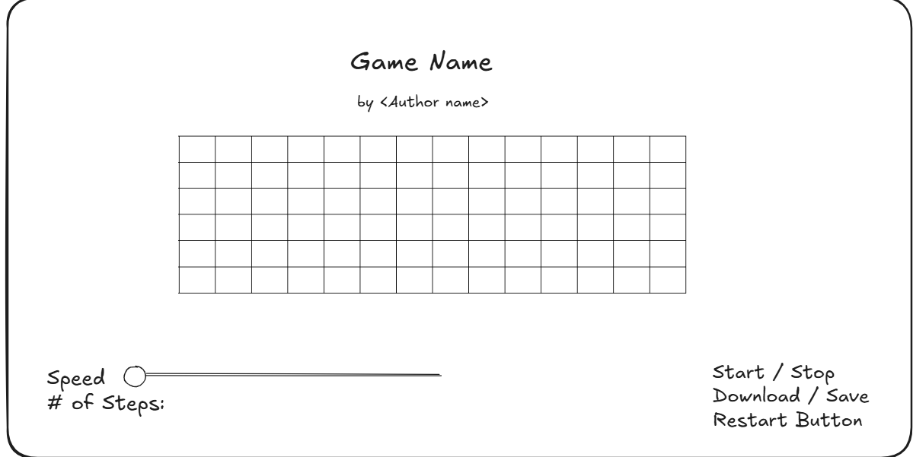
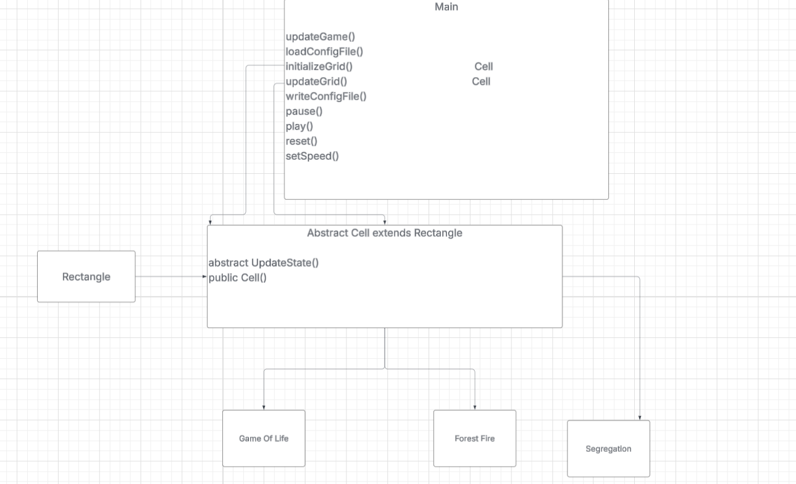

# Cell Society Design Plan
### Team 1
### Michael, Georgiy, Joseph

#### Examples

Here is a graphical look at my design:

made from [a tool that generates UML from existing code](http://staruml.io/).

Here is our amazing UI:

taken from [Brilliant Examples of Sketched UI Wireframes and Mock-Ups](https://onextrapixel.com/40-brilliant-examples-of-sketched-ui-wireframes-and-mock-ups/).

## Introduction
The primary design goals of this project is to be able to make a framework that can run various simulations of cellular automata on a 2-d grid. The designs that are most flexible are the user interface (since you can design/decorate however you want), and the primary architecture of this design centers on transitioning states within each cell of the GUI. Any user input will be private, and the screen is also private. The classes that could be public are the different game mode files, since they all may need to communicate with the Main class in order to actually run the simulation.

## User Interface

## Configuration File Format
This is what our configuration file (XML) would look like:

<?xml version="1.0" encoding="UTF-8"?>

<simulation>
    <!-- What kind of simulation this is -->
    <type>GameOfLife</type>

    <!-- Title shown at the top -->
    <title>Game Of Life</title>

    <!-- Author line -->
    <author>John Conway</author>

    <!-- Description -->
    <description>
        This is a sample Game of Life configuration demonstrating a simple empty grid.
    </description>

    <!-- Grid dimensions -->
    <grid>
        <rows>6</rows>
        <columns>16</columns>

        <!-- Initial cell states -->
        <!-- 0 = DEAD, 1 = ALIVE -->
        <cells>
            <row>0 0 0 0 0 0 0 0 0 0 0 0 0 0 0 0</row>
            <row>0 0 0 0 0 0 0 0 0 0 0 0 0 0 0 0</row>
            <row>0 0 0 0 0 0 0 0 0 0 0 0 0 0 0 0</row>
            <row>0 0 0 0 0 0 0 0 0 0 0 0 0 0 0 0</row>
            <row>0 0 0 0 0 0 0 0 0 0 0 0 0 0 0 0</row>
            <row>0 0 0 0 0 0 0 0 0 0 0 0 0 0 0 0</row>
        </cells>
    </grid>

    <!-- Simulation parameters -->
    <parameters>
        <speed>5</speed>
        <states>
            <state id="0" name="DEAD" color="#FFFFFF"/>
            <state id="1" name="ALIVE" color="#2ECC71"/>
        </states>
    </parameters>
</simulation>

This is what our configuration file (XML) would look like:

<?xml version="1.0" encoding="UTF-8"?>

<simulation>
    <!-- What kind of simulation this is -->
    <type>ForestFire</type>

    <!-- Title shown at the top -->
    <title>Forest Fire Model</title>

    <!-- Author line -->
    <author>Angela Shiflet</author>

    <!-- Description -->
    <description>
        A forest fire configuration with a small cluster of burning trees near the center. Trees adjacent to fire may ignite based on probCatch; empty cells may regrow trees based on probGrow.
    </description>

    <!-- Grid dimensions -->
    <grid>
        <rows>10</rows>
        <columns>16</columns>

        <!-- Initial cell states -->
        <!-- 0 = EMPTY, 1 = TREE, 2 = BURNING -->
           <cells>
      <row>1 1 1 1 1 1 1 1 1 1 1 1 1 1 1 1</row>
      <row>1 1 1 1 1 1 1 1 1 1 1 1 1 1 1 1</row>
      <row>1 1 1 1 1 1 1 1 1 1 1 1 1 1 1 1</row>
      <row>1 1 1 1 1 1 1 1 1 1 1 1 1 1 1 1</row>
      <row>1 1 1 1 1 1 1 2 2 1 1 1 1 1 1 1</row>
      <row>1 1 1 1 1 1 1 2 2 1 1 1 1 1 1 1</row>
      <row>1 1 1 1 1 1 1 1 1 1 1 1 1 1 1 1</row>
      <row>1 1 1 1 1 1 1 1 1 1 1 1 1 1 1 1</row>
      <row>1 1 1 1 1 1 1 1 1 1 1 1 1 1 1 1</row>
      <row>1 1 1 1 1 1 1 1 1 1 1 1 1 1 1 1</row>
    </cells>

    </grid>

    <!-- Simulation parameters -->
    <parameters>
        <speed>5</speed>
        <probCatch>0.60</probCatch>
        <probGrow>0.02</probGrow>

        <states>
            <state id="0" name="EMPTY" color="#FFFFFF"/>
            <state id="1" name="TREE" color="#2ECC71"/>
            <state id="2" name="BURNING" color="#E74C3C"/>
        </states>
    </parameters>
</simulation>

## Design Overview

## Design Details

Comment: need to figure out how game type gets piped into initializing its own games
Also UI class design (?)

Main class: 
updateGame() updates the visual components of the GUI according to the parameters, user input.

loadConfigFile() loads the XML configuration file. It will determine certain instance variables like SIZE

writeConfigFile() should be called to save a XML configuration file based on the state of the game, recording.

## Use Cases

## Design Considerations

## Team Responsibilities

 * Team Member #1

 * Team Member #2

 * Team Member #3
