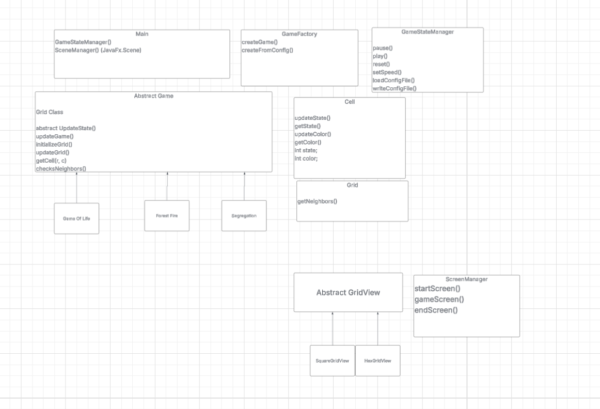

# Cell Society Design Plan
### Team 1
### Michael, Georgiy, Joseph

#### Examples

Here is a graphical look at my design:

made from [a tool that generates UML from existing code](http://staruml.io/).

Here is our amazing UI:

taken from [Brilliant Examples of Sketched UI Wireframes and Mock-Ups](https://onextrapixel.com/40-brilliant-examples-of-sketched-ui-wireframes-and-mock-ups/).

## Introduction
The primary design goals of this project is to be able to make a framework that can run various simulations of cellular automata on a 2-d grid. The designs that are most flexible are the user interface (since you can design/decorate however you want), and the primary architecture of this design centers on transitioning states within each cell of the GUI. Any user input will be private, and the screen is also private. The classes that could be public are the different game mode files, since they all may need to communicate with the Main class in order to actually run the simulation.

## User Interface

## Configuration File Format
This is what our configuration file (XML) would look like:

<?xml version="1.0" encoding="UTF-8"?>

<simulation>
    <!-- What kind of simulation this is -->
    <type>GameOfLife</type>

    <!-- Title shown at the top -->
    <title>Game Of Life</title>

    <!-- Author line -->
    <author>John Conway</author>

    <!-- Description -->
    <description>
        This is a sample Game of Life configuration demonstrating a simple empty grid.
    </description>

    <!-- Grid dimensions -->
    <grid>
        <rows>6</rows>
        <columns>16</columns>

        <!-- Initial cell states -->
        <!-- 0 = DEAD, 1 = ALIVE -->
        <cells>
            <row>0 0 0 0 0 0 0 0 0 0 0 0 0 0 0 0</row>
            <row>0 0 0 0 0 0 0 0 0 0 0 0 0 0 0 0</row>
            <row>0 0 0 0 0 0 0 0 0 0 0 0 0 0 0 0</row>
            <row>0 0 0 0 0 0 0 0 0 0 0 0 0 0 0 0</row>
            <row>0 0 0 0 0 0 0 0 0 0 0 0 0 0 0 0</row>
            <row>0 0 0 0 0 0 0 0 0 0 0 0 0 0 0 0</row>
        </cells>
    </grid>

    <!-- Simulation parameters -->
    <parameters>
        <speed>5</speed>
        <states>
            <state id="0" name="DEAD" color="#FFFFFF"/>
            <state id="1" name="ALIVE" color="#2ECC71"/>
        </states>
    </parameters>
</simulation>

This is what our configuration file (XML) would look like:

<?xml version="1.0" encoding="UTF-8"?>

<simulation>
    <!-- What kind of simulation this is -->
    <type>ForestFire</type>

    <!-- Title shown at the top -->
    <title>Forest Fire Model</title>

    <!-- Author line -->
    <author>Angela Shiflet</author>

    <!-- Description -->
    <description>
        A forest fire configuration with a small cluster of burning trees near the center. Trees adjacent to fire may ignite based on probCatch; empty cells may regrow trees based on probGrow.
    </description>

    <!-- Grid dimensions -->
    <grid>
        <rows>10</rows>
        <columns>16</columns>

        <!-- Initial cell states -->
        <!-- 0 = EMPTY, 1 = TREE, 2 = BURNING -->
           <cells>
      <row>1 1 1 1 1 1 1 1 1 1 1 1 1 1 1 1</row>
      <row>1 1 1 1 1 1 1 1 1 1 1 1 1 1 1 1</row>
      <row>1 1 1 1 1 1 1 1 1 1 1 1 1 1 1 1</row>
      <row>1 1 1 1 1 1 1 1 1 1 1 1 1 1 1 1</row>
      <row>1 1 1 1 1 1 1 2 2 1 1 1 1 1 1 1</row>
      <row>1 1 1 1 1 1 1 2 2 1 1 1 1 1 1 1</row>
      <row>1 1 1 1 1 1 1 1 1 1 1 1 1 1 1 1</row>
      <row>1 1 1 1 1 1 1 1 1 1 1 1 1 1 1 1</row>
      <row>1 1 1 1 1 1 1 1 1 1 1 1 1 1 1 1</row>
      <row>1 1 1 1 1 1 1 1 1 1 1 1 1 1 1 1</row>
    </cells>

    </grid>

    <!-- Simulation parameters -->
    <parameters>
        <speed>5</speed>
        <probCatch>0.60</probCatch>
        <probGrow>0.02</probGrow>

        <states>
            <state id="0" name="EMPTY" color="#FFFFFF"/>
            <state id="1" name="TREE" color="#2ECC71"/>
            <state id="2" name="BURNING" color="#E74C3C"/>
        </states>
    </parameters>
</simulation>

## Design Overview

## Design Details

Comment: need to figure out how game type gets piped into initializing its own games
Also UI class design (?)

Main class: 
updateGame() updates the visual components of the GUI according to the parameters, user input.

loadConfigFile() loads the XML configuration file. It will determine certain instance variables like SIZE

writeConfigFile() should be called to save a XML configuration file based on the state of the game, recording.

## Use Cases

* Apply the rules to a middle cell: set the next state of a cell to dead by counting its number of neighbors using the Game of Life rules for a cell in the middle (i.e., with all its neighbors)

  1. GameOfLife.updateCell(x, y) class will call the RectangularGrid.getNeighbors(x, y) method with the coordinates of the middle cell, receiving a List<Cell> neighbors.
  2. Pass this to the GameOfLife.getNextState(List<Cell>) method, which will return the next int state of the Cell.

     * To accomplish this, the GameOfLife.getNextState() method will iterate through the neighbors, calling Cell.getState() method to get the current state of each of the cells
     * It will return a state based on GameofLife rules.
  3. The return state id will then be used to call Grid.updateCell() method who will then call Cell.updateState() to change its state, color, image, etc.

* Apply the rules to an edge cell: set the next state of a cell to live by counting its number of neighbors using the Game of Life rules for a cell on the edge (i.e., with some of its neighbors missing)

  1. Apply the same flow above; the RectangularGrid.getNeighbors() method will check if the neighbors are in bounds. It will return a List<Cell> containing all neighbors of current cell.

* Move to the next generation: update all cells in a simulation from their current state to their next state and display the result graphically

  1. ScreenManager.step() will call GameOfLife.updateGrid()
  2. GameOfLife.updateGrid() will loop through every possible coordinate (x, y) and call GameOfLife.updateCell(x, y).

* Switch simulations: load a new simulation from a data file, replacing the current running simulation with the newly loaded one

  1. The “Load Simulation” button will be created and defined in the ScreenManager class.
  2. When pressed, ScreenManager will update javaFX using loadScreen() method, allowing user to select different file.
  3. Then ScreenManager will exit the previous game
  4. Then call Simulation.loadConfigFile()

* Set a simulation parameter: set the value of a parameter, probCatch, for a simulation, Fire, based on the value given in a data file

  1. the loadConfigFile() method will be given the filepath to an XML and will parse the data into a dictionary.
  2. Using the type of game specified, that game constructor will be called and passed all the data parsed.
  3. The Fire() constructor will take the parameter probCatch and set its own class variable to that variable

## Additional Use Cases

* Pause and resume a running simulation

  1. When the user clicks the Pause button, the Controller.pause() method is called.
  2. The pause() method stops the timer or loop that repeatedly calls Game.updateGrid().
  3. When the user clicks Play again, the Controller.play() method is called.
  4. The play() method restarts the timer so Game.updateGrid() continues being called on each tick.

* Reset the simulation to its initial configuration

  1. When the user clicks the Reset button, Controller.reset() is called.
  2. The Controller tells the current game to reinitialize its grid using the original configuration data.
  3. After the grid is rebuilt, the Controller triggers the view to re-render so the initial state is displayed again.

* Step through one generation manually

  1. When the user clicks the Step button, Controller.stepOnce() is called.
  2. The Controller calls Game.updateGrid() to advance the model by one generation.
  3. After the update completes, the Controller tells the view to re-render the grid so the updated generation is visible.

* Change simulation speed

  1. When the user adjusts the speed slider, Controller.setSpeed(newSpeed) is called.
  2. The Controller updates the timer interval that controls how frequently Game.updateGrid() is executed.
  3. Future updates occur at the newly selected speed.

* Save the current simulation state to a file

  1. When the user clicks the Save button, Controller.writeConfigFile(path) is called.
  2. The Controller retrieves the current state of each cell by calling Game.getCell(x, y) and then Cell.getState().
  3. The Controller writes the grid data and simulation parameters into a new configuration file.

* Update the graphical display after each generation

  1. Each time the simulation advances (either through Play or Step), the Controller calls Game.updateGrid().
  2. After the model is updated, the Controller tells the current GridView to redraw the screen using the updated cell states.
  3. The view queries each cell’s state and updates its visual appearance accordingly.

## Design Considerations
1. The design consideration of what we should store in Grid to support multiple potential states or undefined states. We decided to store in the Grid class a 2D grid of Object Cell. in order to enable quickly calling any methods needed that are in Cell class. This has a con of needing more storage.

2. We also discussed different ways of implementing the screens whether to create multiple classes or have different methods in one class. We decided to have each screen be a method in the same class. This was to enable sharing of data. The cons is that creating new screens will not be abstracted.

## Team Responsibilities

 * Michael Li: CELL-01 and 02, Main method, Simulation class, Abstract Game class

 * Joseph Wang: CELL-03 and 04, View handler, ScreenManager, File System

 * Georgiy Zemlevskiy: CELL-05 and 06, abstract Grid (with different styles), Cell, 